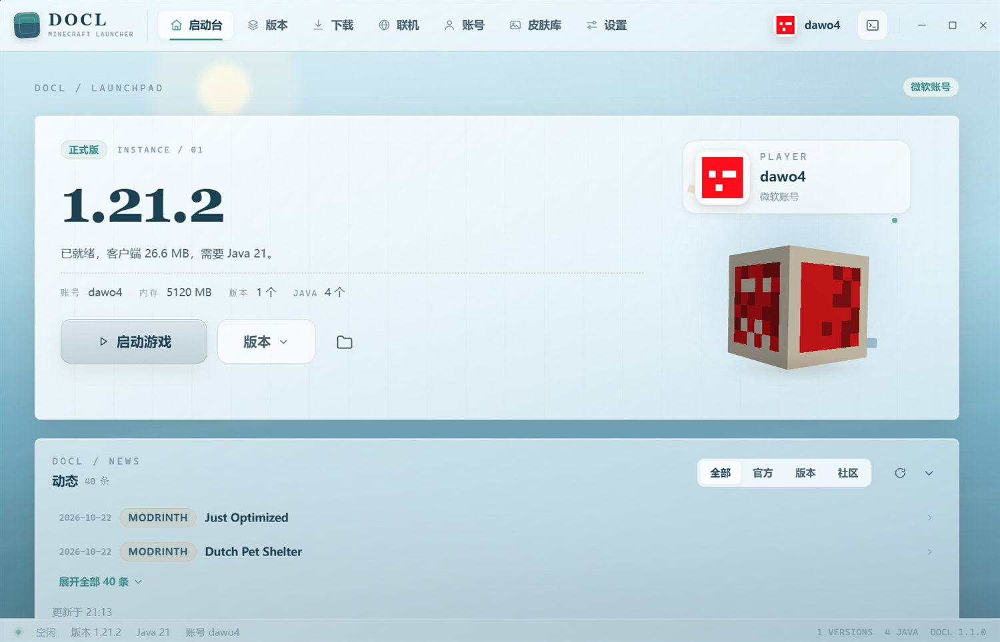
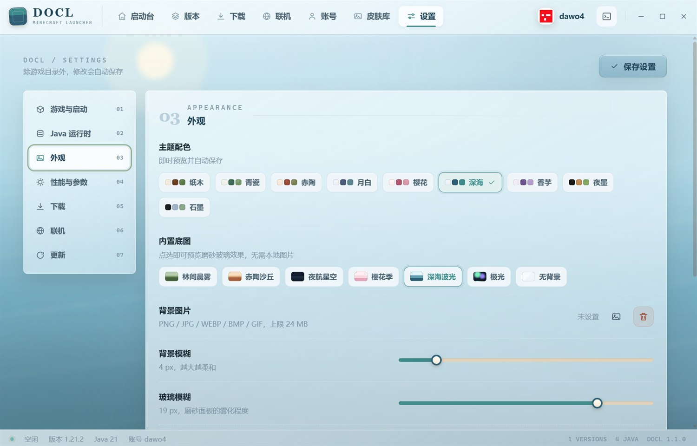
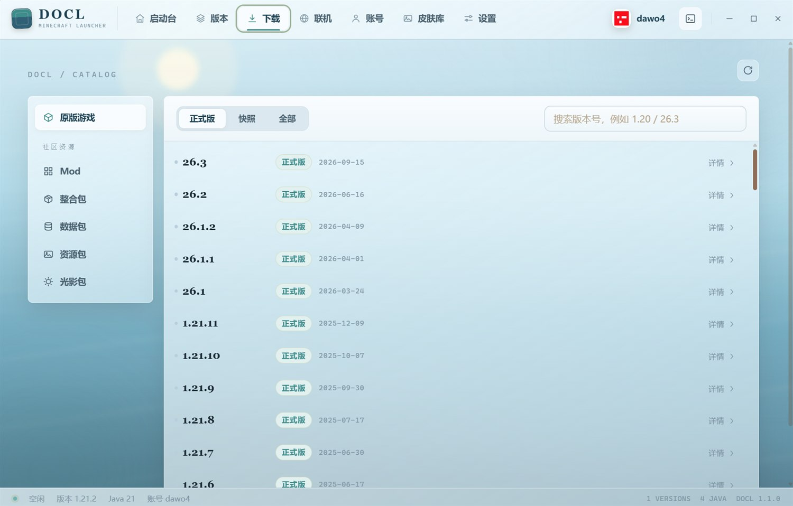
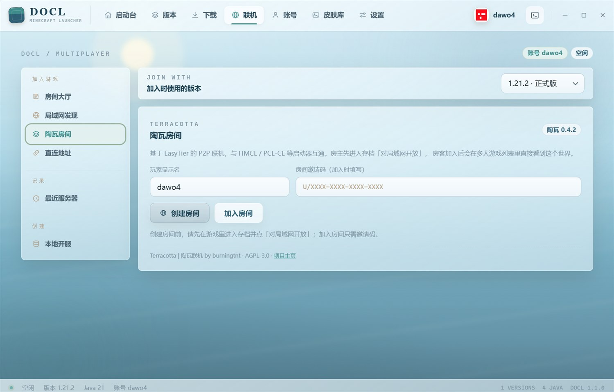
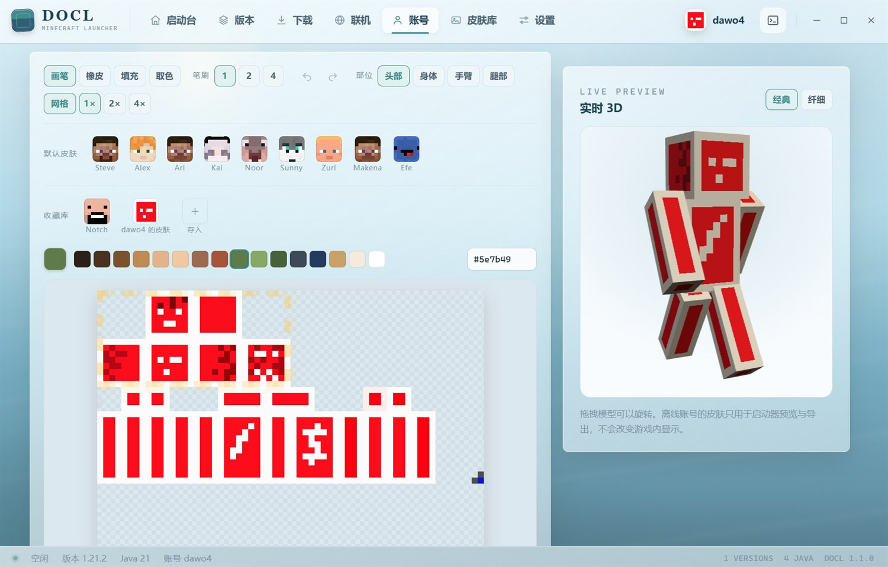
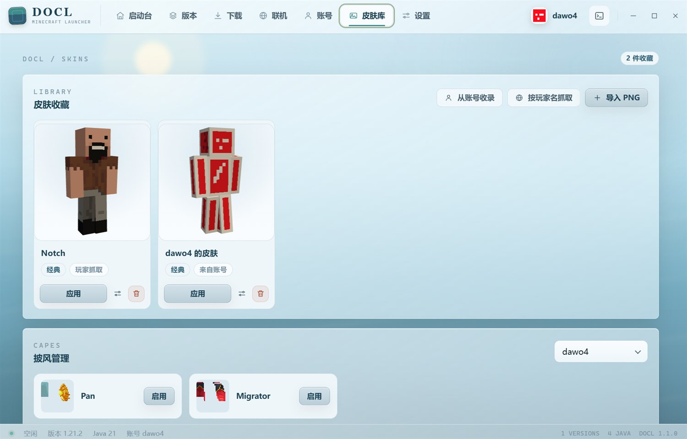
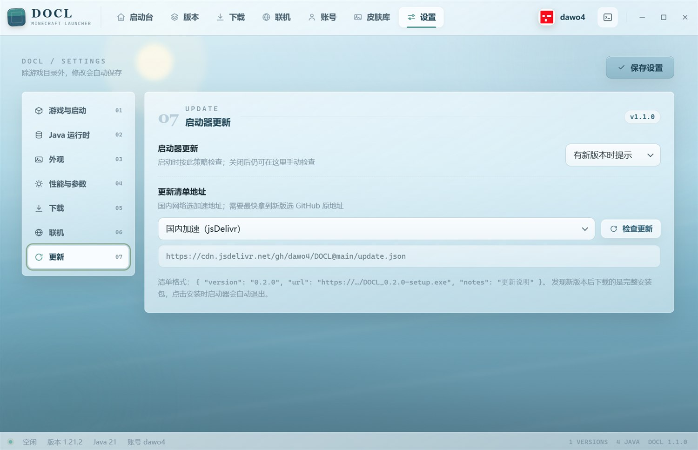

# DOCL

Minecraft 第三方启动器 · Windows · Tauri 2 + Rust + Vue 3

DOCL 把版本管理、下载、联机、皮肤与崩溃诊断收进一个窗口，同时把启动器自身的开销压到很低：安装包 4.5 MB，空闲时主进程内存约 5 MB。

> 本项目与 Mojang Studios / Microsoft 无关，不包含任何游戏本体文件，使用前需拥有正版 Minecraft 账号。



---

## 一、为什么轻

大多数启动器把一整个 Chromium 打包进安装包，动辄一百多兆，运行时还要单独拉起一套浏览器进程。DOCL 换了一条路：

| 项目 | 做法 | 结果 |
| --- | --- | --- |
| 界面渲染 | 复用系统自带的 WebView2 | 安装包约 4.5 MB |
| 业务逻辑 | Rust 后端，不经过 JS 桥接 | 下载、校验、解压、JVM 管理都在原生侧完成 |
| 常驻开销 | 无独立浏览器内核 | 空闲时主进程约 5 MB |
| 冷启动 | 前端体积小、无重型依赖 | 秒开 |

技术栈是 Tauri 2 + Vue 3 + TypeScript + Rust。前端只负责界面，后端负责所有会拖慢速度的活：并行下载、SHA 校验、压缩包解压、NBT 解析、进程管理与日志采集。

省下来的是开销，不是能力——内存自动按物理内存推荐、G1GC / ZGC 参数可切换、Java 运行时自动检测与安装、GPU 优先、启动前命令、逐版本独立参数，这些都在。

---

## 二、界面与个性化

浅色木纹玻璃风，中文优先排版，行高与字距按中文重新调过，不是英文界面套一层翻译。所有卡片、按钮、滑条、下拉、提示气泡都使用同一套材质语言，没有系统原生控件的突兀感。

- 九套配色：纸木、青瓷、赤陶、月白、樱花、深海、香芋、夜墨、石墨
- 六张内置底图，也可以用本地图片
- 磨砂强度、玻璃透明度、背景压暗、圆角、界面密度逐项可调
- 动效可整体关闭
- 设置改完即生效并自动保存，不需要找「应用」按钮



---

## 三、版本管理

原版与 Forge / NeoForge / Fabric / Quilt 统一安装。每个版本都是独立实例，可以单独覆盖内存、Java 路径、窗口尺寸、JVM 参数与启动前命令，互不影响。

- 版本列表为紧凑单行布局，图标可选 7 种预设，也能换成自己的图片
- 多游戏目录切换，工作区之间彼此隔离
- 每个实例的模组、资源包、光影、存档、截图、投影文件集中管理
- 拖入文件即可导入，支持启用 / 禁用

1.2.0 起有两处结构变化：

- **加载器安装内置化**：Forge / NeoForge 不再依赖官方安装器自身的联网流程。版本清单直接从安装器包内抽取，依赖库走启动器已有的镜像下载，补丁由本地 Java 分步执行并校验输出。安装器中途失败不会再留下「提示安装完成、启动即崩」的残缺版本。
- **整合包只占一个条目**：导入后版本列表只显示整合包本身，被继承的原版与加载器不再单独出现；删除整合包时，这些依赖版本一并清理，仍被其他版本共用的会保留。


---

## 四、下载中心

游戏版本、加载器、整合包、资源包、光影、数据包集中在同一页面，来源支持 BMCLAPI 与官方切换，并发数可调。

- Modrinth / CurseForge 搜索，自动按当前实例的游戏版本与加载器过滤
- 已安装模组的更新检查
- 安装模组时自动解析前置依赖并从 Modrinth 补齐，无法识别的会单独列出
- 整合包支持 CurseForge / Modrinth / 通用 ZIP 导入，压缩包拖进窗口即可开始，也可导出为 ZIP 与 `.mrpack`



---

## 五、联机

联机大厅、局域网房间发现、服务器状态 ping 集成在一起；开服与服务器列表管理也在同一处完成，不必再单独打开服务端配置文件。



---

## 六、账号与皮肤

支持正版账号登录、离线账号与皮肤 / 披风切换。内置皮肤编辑器同时支持 64x64 与旧版 64x32 两种规格，颜色用 HSV 取色器调整，本地皮肤库可集中收藏、命名、套用与删除。





---

## 七、诊断与其他

- **崩溃诊断**：崩溃报告会被解析成可读的原因与处置建议，不是把堆栈原样丢出来
- **日志抽屉**：任意页面可随时展开完整启动日志，不必去翻 `.minecraft/logs`
- **存档种子预览**：读取 `level.dat` 中的真实种子，一键跳转在线种子地图
- **投影助手**：实例内的投影文件可直接预览与管理
- **配置备份**：设置可导入导出，换机不丢配置
- **自动更新**：见下节

---

## 八、更新机制

默认策略是「有新版本时提示」，不打扰使用。更新清单来源可在设置中选择：

| 来源 | 地址 | 适用场景 |
| --- | --- | --- |
| 国内加速（默认） | `https://cdn.jsdelivr.net/gh/dawo4/DOCL@main/update.json` | 国内网络 |
| GitHub 原地址 | `https://raw.githubusercontent.com/dawo4/DOCL/main/update.json` | 需要最快拿到新版 |
| 自定义 | 任意 HTTP 地址 | 自建分发 |

清单是一个 JSON 文件：

```json
{
  "version": "1.2.0",
  "url": "https://github.com/dawo4/DOCL/releases/download/v1.2.0/DOCL_1.2.0_x64-setup.exe",
  "notes": "本次更新内容"
}
```

版本号逐段数值比较，只有更高版本才会提示。更新时下载完整安装包并启动安装程序，不做差量补丁，避免残缺文件留存。策略支持「自动下载」「仅提示」「关闭」三档。



---

## 九、安装

- 下载：[Releases](https://github.com/dawo4/DOCL/releases)，文件名为 `DOCL_x.y.z_x64-setup.exe`
- 系统要求：Windows 10 1809 及以上，需 WebView2 运行时（Windows 11 已内置）
- 安装包暂未做代码签名，SmartScreen 可能提示「已保护你的电脑」，点「更多信息」→「仍要运行」即可
- 安装模式为当前用户，无需管理员权限

## 十、本版更新（1.2.0）

- 版本列表改为紧凑单行布局，图标支持预设与自定义图片
- Forge / NeoForge 改为启动器内置安装流程，不再受官方安装器网络问题影响
- 整合包导入后只保留一个版本条目，删除时链式清理继承的依赖版本
- 模组前置依赖自动解析并从 Modrinth 补齐
- 皮肤编辑器新增 HSV 取色器
- 拖拽导入对话框与下载中心细节完善

历史版本变化见 [Releases](https://github.com/dawo4/DOCL/releases)。

---

## 十一、开源

以 [AGPL-3.0](../LICENSE) 许可发布：https://github.com/dawo4/DOCL

修改后分发（包括以网络服务形式提供）需以同等许可公开源代码。
